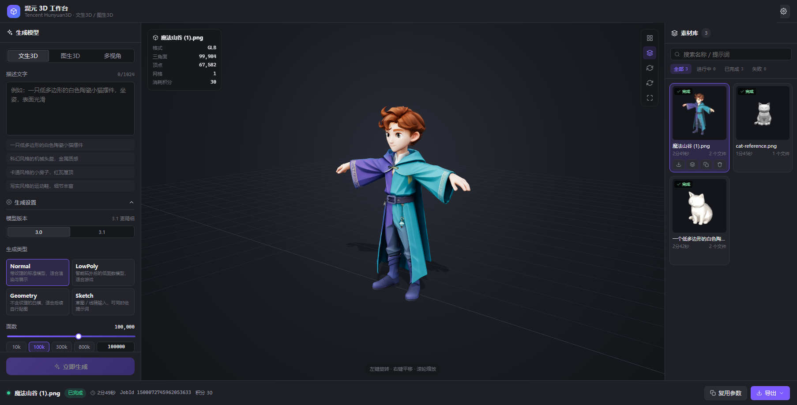
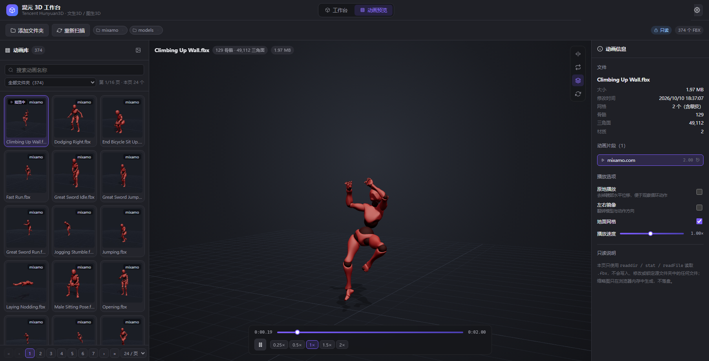

# 3D 生成工作台（Hunyuan3D Workbench）

一个模仿 Tripo3D 工作台的 Web 应用：**只保留工作区里真正会用到的功能** —— 文生3D / 图生3D / 多视角生成、生成参数、任务队列、3D 预览、素材库与导出。

后端**默认对接腾讯混元生3D（专业版）OpenAI 兼容接口** `https://api.ai3d.cloud.tencent.com`，
生成引擎做成可插拔的 provider：内置 **hunyuan3d（默认）/ tripo3d / meshy**，
可在生成面板或设置里切换，也能按同一套契约继续接入其它第三方引擎。



---

## 1. 功能清单

| 区域 | 能力 |
| --- | --- |
| 左侧「生成模型」 | 文生3D（提示词）、图生3D（拖拽 / 点击 / Ctrl+V 粘贴参考图）、多视角（7 个视角槽位，3.1 专属视角自动标注）；输入模式与参数按所选生成引擎的能力自动裁剪 |
| 生成设置 | **生成引擎（混元生3D / Tripo3D / Meshy，默认混元）**、引擎内的模型版本、生成类型 Normal / LowPoly / Geometry / Sketch（按引擎支持范围显示）、面数（对数滑块 + 预设 + 精确输入，按引擎区间收窄）、PBR 材质、多边形类型、输出格式（按引擎支持范围） |
| 中间视口 | three.js 实时预览（GLB / GLTF / OBJ+MTL / STL / FBX）、线框叠加、网格地面、自动旋转、重置视角、全屏、三角面 / 顶点 / 网格 / 积分统计、生成进度（阶段 + 耗时）、**右下角 XYZ 轴向指示器**（随视角实时旋转） |
| 右侧栏 | **「素材库 / 节点」两个页签**：素材库见下一行；**节点**页签展示当前模型的对象层级树，**点击节点即高亮**（琥珀色包围盒 + 淡暖色自发光，`Ctrl/⌘` 多选），支持按名字/类型搜索与折叠 |
| 右侧「素材库」 | 上传 / 批量上传本地模型（按钮选择，或直接把文件拖进面板）、**逐文件上传进度 + 整批取消**（取消会清理服务端暂存）、**分页（每页 12/24/48/96，只渲染当前页）**、**每个素材卡片可「重新生成封面」**（后端 WebGL 重渲染，带版本号刷新缓存）、全部 / 进行中 / 已完成 / 失败筛选、名称与提示词搜索、缩略图、重命名、重试、取消、删除、下载主文件 / 全部文件、复用参数新建 |
| 底部任务条 | 当前任务阶段、耗时、JobId、积分消耗、取消 / 重试（区分「续查」与「重新生成」）、导出菜单（按格式与贴图 / 材质单独下载） |
| 设置弹窗 | 按生成引擎分别填写 API Key（优先于 `.env`）、测试连接、清除、自定义接口域名（代理 / 私有化部署）、切换默认引擎、运行参数展示 |
| **动画预览页** | 顶栏「动画预览」进入：**多文件夹**（可添加/移除，服务端持久记录）、分页浏览、**只加载当前页封面**、**「重新生成本页封面」按钮（服务端重渲染并覆盖缓存）**、模糊搜索、点击即在 3D 视口播放、**骨骼渲染 + 骨骼树多选高亮（可在模型上直接点选骨骼）**、**姿态模式（G/R/S 模态变换）**、**场景节点树（点击节点高亮）**、播放/暂停/进度/倍速、原地播放、左右镜像、地面网格、片段切换、文件与骨骼统计、**右下角 XYZ 轴向指示器**（抬高到播放控制条上方，不被遮挡） |

### 动画预览（只读）



- **多文件夹**：默认 `<仓库上一级>/CozyVale/assets/mixamo`（可用 `.env` 的 `ANIMATION_DIR` 覆盖）。点「添加文件夹」可追加，
  每个文件夹是一个带删除按钮的标签；选择结果保存在服务端 `data/state.json`，刷新/重启后依然保留。
  已失效的文件夹会在标签上标红，扫描时自动跳过并在响应里返回 `missing`。
- **分页**：12 / 24 / 48 / 96 每页可选，页码窗口 + 首/末页跳转；搜索或切换文件夹筛选时自动回到第 1 页。
- **模糊搜索**（`apps/web/src/utils/fuzzy.ts`）：
  - 连续子串优先（`climbing` → `Climbing Up Wall.fbx`）
  - 支持缩写 / 跳字符（`cuw` → `Climbing Up Wall`，`stdwalk` → `Standard Walk`）
  - 空格分隔多关键词，全部命中共存（`unarmed forward`）
  - 关键词可分别命中**文件名或文件夹标签**（`mixamo sword`）
  - 按相关度排序（连续性、词首/驼峰边界、匹配位置、名称长度），命中字符在卡片上高亮
- **封面由后端子线程渲染**：`GET /api/anim/cover` 在 Node `worker_threads` 里用纯 JS 软件光栅器把 FBX
  画成 PNG（含 35% 处的骨骼姿态），浏览器只负责 `` 加载——封面生成不再占用浏览器主线程；
  服务端按 文件+mtime+尺寸+姿态 做 LRU 缓存（最多 400 张，PNG 只在内存里，**不写源文件夹**）。
- **只读保证**：后端只调用 `readdir / stat / readFile`，**不写入任何源文件**，
  读取时整块读入并立刻关闭句柄，因此不会锁文件——游戏引擎等其它进程仍可正常读写这些 FBX。
- 只列出 `.fbx`（Godot 的 `.fbx.import` 边车文件会被自动忽略），整体最多 3000 个文件、单目录递归 4 层、最多记录 20 个文件夹。
- 播放能力：`AnimationMixer` 播放片段、进度条拖动、0.25×–2× 倍速、**原地播放**（去掉髋部水平位移，便于看循环动作）、**左右镜像**、按动画范围的自动取景。
- **骨骼**（右侧面板「骨骼」页签，或用视口右上角的骨骼按钮快速开关）：
  - **两种显示方式，随时切换**（面板里的「点线 / 八面体」分段控件）：
    - **点线**：关节圆点 + 父子连线，看整体结构最清爽。
    - **八面体**：Blender 那种八面体骨头——头部一个点、腰身四点、尾部一个尖，一眼看出一根骨骼的长短与朝向；末端骨骼（手指尖、脚趾尖）顺着父骨方向补一小截，不会只剩一个孤零零的圆点。
    两种方式共用同一套关节圆点与选中状态，切换时选择不丢，切换模型后所选方式也会保留。
  - **渲染**：材质关闭深度测试并抬高 `renderOrder`，骨骼像 DCC 工具那样穿透模型显示（八面体另开平面着色，所以有明暗、能看出朝向）。逐帧从骨骼世界矩阵刷新，所以动画播放时骨骼跟着动。
  - **骨骼树**：完整层级、逐级折叠 / 展开全部 / 折叠到根、按名字搜索（自动展开命中项并高亮）；点击选中，`Ctrl/⌘` 加选或取消，`Shift` 连选。
  - **模型上点选**：直接在视口里点模型选骨骼。取的是**屏幕上离光标最近**的那根骨骼（把骨骼投影到屏幕，按像素距离比较），而不是「射线到点云的距离」——后者用的 `threshold` 是世界单位，投影到屏幕上的可点区域会随距离线性变宽，远处的骨骼反而能抢走光标正对着的那根，表现就是"点不准"。可点半径跟着圆点在屏幕上的大小走，并保底 16px，所以点在肢体中段也能命中最近的关节。
  - **点选前的反馈**：骨骼显示开启时，鼠标划过会实时高亮光标下的骨骼并在旁边显示名字，点下去选中的就是它；拖动超过 4px 视为旋转视角、不触发选择；点空白处清空选择；点选后右侧树会自动滚动到该骨骼。
  - **高亮**：选中的骨骼在 3D 视口与树里同时变琥珀色，视口左上角列出已选骨骼名，可一键清除。
  - **同名包装节点**：Mixamo 的 FBX 会给每根骨骼再套一层同名节点（`Model::` / `LimbNode::`），直接遍历会得到 129 个骨骼对象却只有 65 个唯一名字，树里每根骨头出现两次。这里按「祖先中存在同名骨骼」判定影子节点并剔除（与 three.js 解析动画轨道时按名字取首个匹配的行为一致），再把父子关系提级到最近的真实骨骼上，得到干净的 65 根骨骼树；被忽略的数量会在面板底部说明，不同分支下的同名骨骼不会误删。
- **姿态模式**（Blender 的 Pose Mode，面板里的「姿态模式」开关）：
  - **进入即暂停**：动画停下，骨骼不再被每帧覆盖，手动摆的姿势才能留住（播放按钮会禁用并提示）。镜像会自动关闭——负缩放会让 gizmo 的轴向变得难以预测。
  - **选骨骼 → 拖 gizmo**：选中的骨骼上会出现三轴 gizmo，支持**旋转 / 移动 / 缩放**，坐标空间可选**局部 / 全局**。拖 gizmo 时轨道控制器会让路，松手恢复。
  - **G / R / S 模态变换**（Blender 的肌肉记忆，纯键盘不用碰 gizmo）：按 `G` 移动 / `R` 旋转 / `S` 缩放后用鼠标直接驱动骨骼，顶部会显示实时读数（形如「旋转 Z: 45.0°」）。模态进行中还支持：
    - `X` / `Y` / `Z` 锁定轴向，同键再按一次取消；`Shift+轴` 为平面约束
    - 直接**输入数字**精确取值（如 `G` `X` `0.5` 沿 X 移 0.5），`Backspace` 删一位
    - `Enter` / 鼠标左键确认，`Esc` / 鼠标右键取消并回到操作前
    - `Alt+G` / `Alt+R` / `Alt+S` 把对应分量清回绑定姿态
  - **数值面板**：右侧显示选中骨骼的旋转（度）/ 位置 / 缩放共 9 个可编辑输入框，直接输数值也能摆姿势；模型**实时跟着变形**（SkinnedMesh 每帧走 `skeleton.update()`）。
  - **三级还原**：「还原该骨骼」撤销这根骨骼的手动改动、「还原全部」撤销本次进入姿态模式后的所有改动、「绑定姿态」回到 FBX 原始的绑定姿态（`Alt+G/R/S` 的语义）。
  - **改动基准**取"进入姿态模式那一刻"的姿态。若拿绑定姿态当基准，动画一播放就会显示"半数骨骼已改"，既没意义也容易让人误以为重置会毁掉动画。
- **场景节点树**（右侧面板「节点」页签）：展示模型的对象层级（Group / Mesh / SkinnedMesh / Bone…）。
  - **点击节点即高亮**：给该对象套一个琥珀色包围盒（`depthTest: false` 穿透显示），并把其网格材质的自发光染成**淡暖色**（`emissiveIntensity = 0.18`，保留原有明暗，不把模型糊成一片纯色）；包围盒随动画逐帧刷新。
  - `Ctrl/⌘` 多选、搜索节点名或类型（自动展开命中项的祖先路径）、逐级折叠 / 全部展开 / 折叠到根。
  - 「含骨骼节点」默认关闭——骨骼在「骨骼」页签里有更细的界面；打开后可见完整 132 个节点（129 骨骼对象 + 3 个对象），父节点会标注子树里的骨骼数量。
  - 同一套面板也用于**工作台**（右侧栏「节点」页签），实现共用 `apps/web/src/viewer/sceneNodes.ts` 里的 `buildSceneTree` + `NodeHighlighter`，因此 GLB / GLTF / OBJ / STL / FBX 都能用。

**刻意移除**（Tripo3D 里非工作区的内容）：首页 / 资产导航页签、订阅与积分购买、模型私密性与分享、发送至 3D 软件、3D 打印、AI 模型试玩入口、ICP 备案footer、客服浮窗。

---

## 2. 技术栈

- **后端**：Node.js 22 + TypeScript + Fastify 5（ESM，`tsc` 编译，`tsx` 开发热重载）
- **前端**：Vue 3（`<script setup>` + TypeScript）+ Vite 6 + Pinia + three.js
- **持久化**：本地 JSON 状态文件 + 文件系统素材库（无外部数据库）

```
3d-desing/
├── apps/
│   ├── api/                     # Fastify 服务 + 生成引擎适配 + 任务调度
│   │   └── src/
│   │       ├── config.ts        # 环境变量与运行参数
│   │       ├── app.ts           # 应用装配（路由 / 静态资源 / 错误处理）
│   │       ├── index.ts         # 启动入口
│   │       ├── providers/       # 生成引擎：契约 / 注册表 / http 工具 / 各引擎适配器
│   │       │   ├── types.ts     # GenerationProvider 契约（submit / query / download / verify）
│   │       │   ├── registry.ts  # 引擎注册表（默认 hunyuan3d）
│   │       │   ├── hunyuan3d.ts # 腾讯云混元生3D（默认引擎）
│   │       │   ├── tripo3d.ts   # Tripo3D 开放 API v2
│   │       │   └── meshy.ts     # Meshy v2（preview → refine 两步）
│   │       ├── hunyuan/         # 混元接口的线上协议与客户端
│   │       ├── services/        # 调度器、素材转存、任务输入、设置、重试/取消、封面渲染池
│   │       ├── covers/          # 封面 Worker：three Loader + headless-gl(WebGL1) 管线 / 软件光栅器兜底 + PNG 编码
│   │       ├── routes/          # /api/* 与 /files/*
│   │       └── store/           # 工作区状态（state.json）
│   └── web/                     # Vue 3 工作台
│       └── src/
│           ├── api/             # 接口客户端与类型
│           ├── components/      # 顶栏 / 生成面板 / 视口 / 素材库 / 任务条 / 设置
│           │   └── animation/   # 动画预览页：网格 / 视口 / 信息面板 / 文件夹选择
│           ├── stores/          # Pinia 工作区状态与轮询
│           ├── viewer/          # three.js 预览器（ModelViewer / FbxPlayer / SkeletonOverlay / 轴向指示器 / 缩略图渲染）
│           └── utils/           # 图片压缩与校验、格式化
└── data/                        # 运行期数据（自动创建，已 gitignore）
    ├── state.json               # 任务与素材元数据
    ├── payloads/                # 提交任务的完整输入（供重试复用）
    └── storage/<jobId>/         # 转存后的模型、材质、贴图、缩略图
```

---

## 3. 快速开始

要求：Node.js ≥ 20（开发建议 22），npm 10+。

```bash
# 1. 安装依赖
npm install

# 2. 配置 API Key（可跳过，改为启动后在界面右上角「设置」里填写）
copy .env.example .env        # Windows
# cp .env.example .env        # macOS / Linux
# 编辑 .env：默认引擎填 HUNYUAN3D_API_KEY=sk-xxxxxxxx；
# 要用 Tripo3D / Meshy 时再补 TRIPO3D_API_KEY=tsk_xxx / MESHY_API_KEY=msy_xxx

# 3. 开发模式（前端 5173 + 后端 8787，已配置代理）
npm run dev                   # 打开 http://127.0.0.1:5173

# 4. 生产模式：构建后由后端统一托管前端
npm run build
npm start                     # 打开 http://127.0.0.1:8787
```

常用脚本：

| 命令 | 说明 |
| --- | --- |
| `npm run dev` | 同时启动 API（`tsx watch`）与 Vite 开发服务器 |
| `npm run build` | 构建前端静态资源 + 编译后端 TypeScript |
| `npm start` | 启动生产服务（同时托管 `apps/web/dist`） |
| `npm run typecheck` | 前后端类型检查（`tsc` + `vue-tsc`） |
| `npm test` | 一次性跑四套自测：模糊搜索单测 + 状态恢复/取消语义 + 封面渲染 + 生成引擎（全部离线，不联网不扣积分） |
| `npm run test:cover -w @h3d/api` | 封面渲染自测：WebGL 引擎、OBJ / glTF / 带贴图 GLB / FBX（含骨骼姿态）、并发、Worker 复用、软件兜底、项目内磁盘缓存 |
| `npm run test:state -w @h3d/api` | 状态恢复、素材清理安全阀、过期暂存清理、worker 取消语义 |
| `npm run test:providers -w @h3d/api` | 生成引擎自测（mock 网络，覆盖三引擎的提交/轮询/多步/下载/转存/取消/重试，**不联网不扣积分**） |
| `npm run smoke -- --prompt "一只小猫" --faces 3000 --yes` | 直连当前引擎跑一次完整生成（**会消耗积分**；`--provider tripo3d` 可切引擎） |

> 如果 `npm install` 在受限环境（例如带文件沙箱的容器）里因 esbuild 的安装脚本失败，可改用
> `npm install --ignore-scripts`：esbuild 的平台二进制由可选依赖提供，不跑安装脚本也能正常工作。

### 环境变量

| 变量 | 默认值 | 说明 |
| --- | --- | --- |
| `HUNYUAN3D_API_KEY` | 空 | 混元生3D 的 `sk-` 密钥（默认引擎）；界面里填写的 Key 优先级更高 |
| `HUNYUAN3D_BASE_URL` | `https://api.ai3d.cloud.tencent.com` | 混元接口域名 |
| `TRIPO3D_API_KEY` | 空 | Tripo3D 的 `tsk_` 密钥 |
| `TRIPO3D_BASE_URL` | `https://api.tripo3d.ai/v2/openapi` | Tripo 接口域名 |
| `MESHY_API_KEY` | 空 | Meshy 的 `msy_` 密钥 |
| `MESHY_BASE_URL` | `https://api.meshy.ai/openapi/v2` | Meshy 接口域名 |
| `GENERATION_PROVIDER` | `hunyuan3d` | 服务端默认引擎（`hunyuan3d` / `tripo3d` / `meshy`） |
| `HOST` / `PORT` | `127.0.0.1` / `8787` | 本地服务监听地址 |
| `WEB_HOST` | `127.0.0.1` | Vite 开发/预览服务器监听地址（在 `apps/web` 侧读取，需用命令行环境变量设置） |
| `POLL_INTERVAL_MS` | `5000` | 远端任务轮询间隔 |
| `MAX_CONCURRENCY` | `3` | 本地并发上限（接口默认提供 3 个并发，代码里强制作不超过 3） |
| `ANIMATION_DIR` | `../CozyVale/assets/mixamo` | 动画预览默认打开的 FBX 文件夹（只读） |
| `H3D_DATA_DIR` | `<仓库>/data` | 数据目录覆盖（独立实例 / 便携部署 / 测试用） |

> 开发服务器固定监听 IPv4 回环 `127.0.0.1`：Node 18+ 在 Windows 上把 `localhost` 解析为 `::1`，
> Vite 默认只绑 `[::1]`，导致 `http://127.0.0.1:5173` 连接被拒。现在 `http://127.0.0.1:5173`
> 与 `http://localhost:5173` 都可用；需要给局域网/容器访问时用 `WEB_HOST=0.0.0.0 npm run dev`
> （注意这会把端口暴露到所有网卡）。

---

## 4. 混元生3D 接口对接

### 4.1 鉴权与地址

```
Authorization: sk-xxxxxxxxxxxxxxxx        # 直接放 API Key，无需 Bearer 前缀
Content-Type:  application/json
```

| 用途 | 方法与路径 |
| --- | --- |
| 提交生成任务 | `POST https://api.ai3d.cloud.tencent.com/v1/ai3d/submit` |
| 查询任务结果 | `POST https://api.ai3d.cloud.tencent.com/v1/ai3d/query` |

提交成功返回 `{"Response":{"JobId":"...","RequestId":"..."}}`；
业务校验失败（HTTP 200）返回 `{"Response":{"Error":{"Code":"...","Message":"..."}}}`；
鉴权失败返回 HTTP 401 `{"error":{"code":"invalid_api_key", ...}}`。客户端对这三类都做了区分处理
（见 `apps/api/src/hunyuan/client.ts`）。

### 4.2 请求参数（PascalCase）

| 参数 | 说明 |
| --- | --- |
| `Model` | `3.0` / `3.1`；**3.1 不支持 `LowPoly` 与 `Sketch`** |
| `Prompt` | 文生3D 描述，≤1024 字符；与其他图片输入互斥（`Sketch` 模式除外） |
| `ImageBase64` | 参考图 base64（可带 `data:image/...;base64,` 前缀，本项目发送裸 base64），≤6MB，单边 128–5000 |
| `MultiViewImages` | `[{ViewType, ViewImageUrl \| ViewImageBase64}]`，`ViewType` 取值 `left/right/back/top/bottom/left_front/right_front` |
| `GenerateType` | `Normal` / `LowPoly` / `Geometry` / `Sketch` |
| `FaceCount` | 3000–1500000；`LowPoly` 时忽略 |
| `EnablePBR` | `Geometry` 时忽略 |
| `PolygonType` | `triangle` / `quadrilateral`，仅 `LowPoly` 生效 |
| `ResultFormat` | `OBJ` / `GLB` / `STL` / `FBX` / `USDZ`，**必须大写**；不传则默认同时返回 OBJ 与 GLB |

### 4.3 查询结果

```jsonc
{
  "Response": {
    "Status": "WAIT | RUN | FAIL | DONE",
    "ErrorCode": "...", "ErrorMessage": "...",
    "ResultFile3Ds": [
      { "Type": "OBJ", "Url": "https://.../xxx.zip", "PreviewImageUrl": "https://.../preview.png" },
      { "Type": "GLB", "Url": "https://.../xxx.glb" }
    ],
    "ResultCreditConsumed": 30,
    "ResultCreditDetails": "{\"FaceCount\":10,\"GenerateType-Normal\":20}"
  }
}
```

> **结果 URL 仅 24 小时有效**，因此服务端在任务完成时会立即把文件下载并转存到
> `data/storage/<jobId>/`，界面与下载链接都指向本地 `/files/...`，不会过期。
> `Type=OBJ` 返回的是 zip 包，服务端会自动解包并识别主模型 / `.mtl` / 贴图
> （`apps/api/src/services/assets.ts`）。

---

## 5. 运行时设计

- **任务队列**：`GenerationWorker` 最多同时推进 3 个远端任务；每 5 秒轮询一次状态。
- **断点续跑**：任务与 `remoteJobId` 落盘，服务重启后会自动接管仍在执行的远端任务继续查询，
  **不会重复提交、不会重复计费**。
- **自动重试**：轮询与远端取消这类幂等请求遇到网络抖动 / 限流 / 5xx 会做指数退避重试（4 次，带抖动），
  避免一次抖动就把付费任务判死；连续失败才落「失败」并提示「重试 = 续查远端，不重复计费」。
  提交任务**不做自动重试**（请求可能已发出并计费），失败走手动重试。
- **取消语义**：取消会立刻在本地置为「已取消」，并 best-effort 通知引擎取消远端任务
  （Tripo `POST /task/{id}/cancel`、Meshy `DELETE /{kind}/{id}`；引擎不支持时如实提示「已停止本地跟踪，远端可能仍会计费」）。
  取消发生在下载阶段时会保留已转存的结果。
- **状态安全**：启动时写 `data/state.json.bak` 快照；`state.json` 损坏/丢失会先从备份恢复，
  损坏文件改名隔离（`state.json.corrupt-<时间>`）而不是静默覆盖；发生过恢复的启动会**跳过素材目录清理**，
  空状态也不会批量删除 `data/storage`（双重安全阀，避免"丢记录 + 删模型"）。
- **重试语义**：因网络中断导致的失败，重试只「续查」远端任务；远端明确判定失败时，
  重试会重新提交（界面按钮文案会明确提示「再次计费」）。
- **响应压缩**：`/api/state` 等 JSON 响应在客户端支持时 gzip（实测 27 KB → 3.7 KB），素材文件走原样传输。
- **过期暂存清理**：启动时清掉超过 24h 的 `data/uploads/.staging` 残留（浏览器中途关闭/进程崩溃的兜底）。
- **上传进度与取消**：单文件暂存改用 XHR（`upload.onprogress`）显示百分比；「取消」会 abort 当前请求并
  `DELETE /api/library/staging/:batchId` 清理已暂存文件，不会产生半成品素材。
- **素材库分页**：每页 12/24/48/96 可选，只渲染当前页卡片（缩略图也只加载当前页），
  搜索 / 筛选 / 改每页数量都会回到第 1 页，删除任务后页码自动夹回有效范围。
- **进度展示**：接口只返回 `WAIT/RUN/FAIL/DONE`，不返回百分比，界面按耗时给出收敛的估算进度并标注为估算值。
- **缩略图 / 封面**：优先使用接口返回的 `PreviewImageUrl`；若缺失，先请求后端
  `POST /api/jobs/:id/cover` 由 worker 子线程渲染（三引擎产物与上传件都支持 GLB/glTF/OBJ/FBX/STL），
  后端不支持或失败时才回退浏览器离屏渲染（`POST /api/jobs/:id/thumbnail`）。
- **封面 Worker**：`apps/api/src/covers/worker.mjs` 在 `worker_threads` 里跑 three 的 Loader（无 DOM 垫片）：
  - 首选 **headless-gl（`gl`）** 提供真实 WebGL1 上下文，自写一套最小的 shader 管线（顶点色/法线/UV + 贴图采样），
    贴图用 `pngjs` / `jpeg-js` 解码成 RGBA 上传，封面与浏览器里看到的模型一致；
  - **光照/色调/阴影与前端一致**：ACES Filmic tone mapping + exposure 1.05、sRGB 输出；半球光 white/#404652 强度 1.15、
    主光 white 2.1（4,6.5,4.5）、轮廓光 #bcd0ff 0.75（-5,3,-5）、环境光强度 0.85；深色背景 **#1b1e25**（与前端
    `captureThumbnail` / `captureFrame` 填充一致）；地面画一层软接触阴影（近似前端 `ShadowMaterial` opacity ≈0.28）；
  - headless-gl 不可用时自动退回纯 JS 软件光栅器（贴图只取主色，但同样补深色底），封面仍能生成；
  - PNG 用 `node:zlib` 自己编码；只跑 **1 个 worker**（headless-gl 原生模块不能在同一进程的多个 worker 里重复加载），
    串行复用、超时销毁重建。
- **封面缓存（不写系统盘）**：动画封面三级缓存 —— 内存 LRU（400 张）→ 项目内磁盘 `data/cache/covers/<sha1>.png`
  （key 含文件 mtime，命中后毫秒级返回；启动时清理 30 天前的旧文件；`data/` 已 gitignore）→ 真正渲染。
- **图片输入**：前端在浏览器内校验格式 / 最小边长（≥128）、等比压缩到长边 1600、控制体积 ≤6MB，
  再以 base64 提交（`apps/web/src/utils/image.ts`）。

### 生成引擎（可插拔 provider）

默认引擎是**混元生3D**；`apps/api/src/providers/` 把「提交 → 轮询 → 下载 → 校验」抽象成统一契约
（`GenerationProvider`），第三方引擎只需实现同一套方法即可接入，worker / 路由 / 前端都不用改。

| 能力 | `hunyuan3d`（默认） | `tripo3d` | `meshy` |
| --- | --- | --- | --- |
| 输入模式 | 文生 / 图生 / 多视角（7 视角） | 文生 / 图生 / 多视角（2~4 张按多视角提交，1 张退化为单图） | 文生 / 图生 |
| 生成类型 | Normal / LowPoly / Geometry / Sketch | Normal / LowPoly / Geometry | Normal / LowPoly / Geometry |
| 面数区间 | 3,000 ~ 1,500,000 | 3,000 ~ 20,000（超出自动收窄） | 3,000 ~ 300,000 |
| PBR | ✅ | ✅ | ❌（贴图在 refine 阶段产出） |
| 输出格式 | OBJ / GLB / STL / FBX / USDZ | GLB | GLB / FBX / OBJ / USDZ |
| 多步流程 | 无 | 无 | 文生3D `preview → refine`（阶段信息存 `job.providerMeta`，重启可续跑） |

- **任务绑定引擎**：每个任务的 `params.provider` 决定用哪个引擎；「复用参数」会跟着切到那个引擎。
- **Key / 域名按引擎独立**：界面设置优先于 `.env`；支持自定义接口域名（代理 / 私有化部署）。
- **能力驱动表单**：`/api/providers` 下发 `capabilities`，前端自动隐藏不支持的模式/参数，服务端再校验一次
  （例如 Meshy 拒绝多视角与 Sketch、Tripo 拒绝 OBJ、面数超出引擎区间会被收窄）。
- **错误统一**：各引擎的鉴权/限流/参数错误统一映射为 `ProviderError`（`AuthFailure.*`、`RateLimited`、
  `NetworkError`、`InvalidParameter.*`），任务卡片的失败原因与界面提示一致。
- **远端取消（可选契约）**：`GenerationProvider.cancel?()`，Tripo / Meshy 已实现（以官方文档为准，
  端点不存在时返回 `false` 并提示「远端可能仍会计费」；混元没有取消接口则不实现）；调用是 best-effort，
  失败也会保证本地立即取消。
- **重试**：`services/retry.ts` 对幂等调用做指数退避 + 抖动，只有 `ProviderError.retryable`
  （网络 / 限流 / 5xx / 超时）才重试。

新增一个第三方引擎（3 步）：

1. 在 `apps/api/src/providers/` 下实现 `GenerationProvider`：`info`（能力/模型/默认参数/Key 说明）、
   `submit`、`query`、`download`、`verify`，需要时再加 `normalizeParams` 做参数裁剪、
   `cancel` 通知远端取消（可选）；
2. 把引擎 id 加进 `store/types.ts` 的 `PROVIDER_IDS` 与 `providers/registry.ts` 的 `REGISTRY`；
3. 想用 `.env` 配 Key 时，在 `info` 里声明 `envKeyName` / `envBaseUrlName`（`config.ts` 会自动读取）。

前端无需改动：引擎选项、能力裁剪、Key 设置面板全部由 `/api/providers` 与 `/api/settings` 驱动。
自测脚本 `npm run test:providers -w @h3d/api` 用 mock `fetch` 覆盖三个引擎（含 Meshy 两阶段、Tripo 先上传再提交），
不联网、不消耗积分。

### HTTP 接口一览

| 方法 | 路径 | 说明 |
| --- | --- | --- |
| GET | `/api/state` | 前端唯一轮询入口：任务列表 + 队列 + 设置摘要 |
| GET | `/api/providers` | 生成引擎清单（能力、模型、默认参数、Key 状态、接口域名） |
| POST | `/api/jobs` | 创建生成任务（`params.provider` 指定引擎，缺省用服务端默认引擎） |
| GET | `/api/jobs/:id` | 任务详情 |
| PATCH | `/api/jobs/:id` | 重命名；未提交的任务可改参数（含切换引擎） |
| POST | `/api/jobs/:id/retry` | 重试（自动选择续查 / 重新提交） |
| POST | `/api/jobs/:id/cancel` | 取消（本地立即生效 + best-effort 通知远端，返回 `remote: ok/unsupported/failed/not-submitted`） |
| DELETE | `/api/jobs/:id` | 删除任务与本地素材文件 |
| POST | `/api/jobs/:id/cover` | 后端子线程渲染素材封面（GLB/glTF/OBJ/FBX/STL）；`force=true` 强制重渲染（带 `?v=` 版本号刷新缓存），失败时前端回退到 `thumbnail` |
| POST | `/api/jobs/:id/thumbnail` | 回填浏览器渲染的缩略图 |
| GET | `/api/jobs/:id/preview` | 输入参考图预览 |
| GET | `/api/settings` | 设置摘要（按引擎的 Key 状态、能力、限制、枚举） |
| PUT/DELETE | `/api/settings/api-key?provider=` | 保存 / 清除某个引擎的 API Key |
| PUT | `/api/settings/base-url?provider=` | 设置某个引擎的自定义接口域名（空串恢复默认） |
| PUT | `/api/settings/active-provider` | 切换服务端默认引擎 |
| POST | `/api/settings/verify?provider=` | 某个引擎的 Key / 连通性自检 |
| GET | `/api/library/upload-info` | 允许上传的扩展名与单文件上限 |
| PUT | `/api/library/staging/:batchId?filename=xxx` | 上传单个文件（`application/octet-stream` 原始字节流，服务端流式落盘） |
| POST | `/api/library/commit` | 把一个批次转成素材库条目（支持批量，按规则分组） |
| DELETE | `/api/library/staging/:batchId` | 放弃该批次并清理暂存文件 |
| GET | `/files/:jobId/<相对路径>` | 本地素材文件（`?download=1` 触发附件下载） |
| GET | `/api/anim/info` | 动画预览的文件夹、默认目录与限制 |
| GET | `/api/anim/dirs` · PUT `/api/anim/dirs` | 读取 / 保存记录的 FBX 文件夹（持久化，只做存在性校验） |
| GET | `/api/anim/list?dir=&dir=` | 递归列出多个文件夹下的 `.fbx`（重复 `?dir=`；不传则用已记录的） |
| GET | `/api/anim/browse?dir=` | 浏览子目录，用于「选择文件夹」（只读） |
| GET | `/api/anim/file?path=\|dir=&name=` | 读取单个 `.fbx`（只读、不落盘、不锁文件、`no-store`） |
| GET | `/api/anim/cover?path=&size=&pose=&refresh=` | 后端子线程渲染动画封面（PNG，ETag + LRU/磁盘缓存；`refresh=1` 跳过缓存强制重渲染） |

### 上传 / 批量上传规则

- 前端把选中的文件逐个 PUT 到同一 `batchId` 的暂存目录，全部暂存完成后才调用 `commit`，
  由服务端按批次统一分组；无论成功或失败都会清理暂存目录。
- 分组规则：
  - `.zip` → 单独一个素材并自动解包（与原接口结果处理方式一致）
  - `.glb` / `.stl` / `.fbx` / `.usdz` → 各自一个素材
  - `.obj` / `.gltf` → 一个素材，并自动吸收同批次的 `.mtl` / `.bin` / 贴图，材质引用保持可解析
  - 只选了 `.mtl` / 贴图而没有主文件 → 明确报错「和 .obj/.gltf 一起选，或打包成 .zip」
- 扩展名白名单与单文件上限由 `/api/library/upload-info` 下发（默认 17 种扩展名，单文件 ≤ 200MB）。
- 上传素材与生成素材共用同一套存储与接口，预览 / 导出 / 重命名 / 删除直接可用；
  卡片上带「上传」标识，且不显示无意义的「复用参数」按钮。
- **缩略图自动生成**：上传的模型没有接口返回的预览图，前端用一个挂在屏幕外、固定 512×512 的
  `ModelViewer`（`apps/web/src/viewer/thumbnailRenderer.ts`）逐个渲染并回填，因此批量上传后无需任何手动操作。
  - 上传完成后立即为本次新增的素材生成；页面首次加载时也会自动补全历史缺失的缩略图（一次最多 30 个）。
  - 顺序处理（同一时刻只占一个 WebGL 上下文），页面标题栏显示 `缩略图 3/13` 进度；缺少缩略图时
    标题栏会出现「补全缩略图 N」按钮可手动触发。
  - WebGL 上下文创建失败时自动放弃并且不反复重试，不影响其它功能。

---

## 6. 已验证情况

本版本已用提供的 API Key 做过真实端到端验证：

| 用例 | 结果 |
| --- | --- |
| 文生3D（`一只低多边…陶瓷小猫摆件`，Normal / 3000 面 / GLB） | 2 分 42 秒完成，返回 OBJ(zip)+GLB 两组文件，扣 30 积分；OBJ 自动解包出 `.obj` + `material.mtl` + `texture_20250901.png`，GLB 校验为合法 glTF 2.0（magic `glTF`，version 2） |
| 图生3D（用上一轮的预览图作为输入，Geometry / GLB） | 1 分 45 秒完成，扣 25 积分，仅返回 GLB，输入预览图正常落盘与展示 |
| 请求体形状 | 逐一校验 `ImageBase64`(裸/data URI)、`MultiViewImages`、`GenerateType`、`PolygonType`、`ResultFormat`（大小写敏感）、`FaceCount` 范围等参数行为 |
| 前端 | 无头 Chrome 截图核对：文生3D / 图生3D（浏览器内压缩出 512×512、88.1 KB）/ 多视角 7 槽位 / 设置弹窗 / 线框叠加 / 素材库两列布局（固定 300px，每行 2 个，无横向溢出）/ 上传与批量上传；页面同源请求 0 失败、0 个 4xx/5xx、0 条控制台错误 |
| 上传 / 批量上传 | 混批 4 个文件（GLB + OBJ 套装）→ 正确生成 2 个素材：OBJ+MTL+贴图合并为一个且材质可解析（视口中带贴图渲染成功），GLB 独立成条；`.zip` 自动解包；不支持的扩展名返回 415；只有贴图无主文件时给出明确提示且暂存目录不残留 |
| 缩略图自动生成 | 通过 UI 批量上传 5 个 GLB（各 17MB）后**不做任何点击**，缩略图在约 43 秒内从 11/16 自动补全到 16/16，全程 0 控制台错误 |
| 存储清理 | 启动时清理无任务记录 / 空的素材目录（实测把 15 个目录收敛到与 12 个任务一一对应）；上传中途失败会回滚半成品目录 |
| 动画预览 | 打开 `D:\sgames\CozyVale\assets\mixamo`：识别 18 个 Mixamo FBX（129 骨骼 / 49,112 三角面 / 带蒙皮），自动播放首个动画、进度推进正常、缩略图 18/18 自动生成；文件夹选择器可向上导航到 `assets` 并列出 6 个子目录及各自的 FBX 数量；0 控制台错误、0 请求失败 |
| 多文件夹 + 分页 + 按页封面 | 记录 `mixamo` + `models` 两个文件夹 → 374 个 FBX、共 16 页（24/页）；第 1 页只渲染 24 张卡片；封面改为后端渲染后只对进入可视区的卡片请求 `/api/anim/cover`（CDP 观测到 24 张卡片中 12 张先挂上封面、12 张懒加载占位），翻页同理；回看已渲染过的文件命中服务端 LRU + 浏览器 HTTP 缓存，不再解析 FBX |
| 模糊搜索 | 单元测试 20 项断言全通过（`apps/web/scripts/fuzzy.test.ts`：子串优先、`cuw`/`stdwalk`/`gsi` 缩写、多关键词、不命中、高亮）；浏览器实测 `cuw` → `Climbing Up Wall.fbx`、`stdwalk` → `Standard Walk.fbx`、`unarmed forward` 精确命中 1 条、`mixamo sword` 一词命中标签一词命中名称得 9 条、`zzzz` 显示「没有匹配」 |
| 骨骼渲染与选择 | Mixamo FBX：129 个骨骼对象识别出 **65 根真实骨骼**、忽略 64 个同名包装节点，树里 0 重名、层级为 `Hips→Spine→Spine1→Spine2→Neck→Head` 与 `RightShoulder→RightArm→RightForeArm→RightHand→各手指`；`Ctrl` 加选（1→2→3 根）、再点已选中的取消（3→2）、`Shift` 连选得到准确计数；搜索 `hand` 过滤到 94 行并高亮命中的 47 根；**在模型上直接点击命中骨骼**，悬停显示的骨骼名与点击选中的完全一致（store 与树 DOM 双向核对），点空白处清空；0 控制台错误 |
| 点选精度 | 暂停动画后测量关节的可点范围：以命中点为圆心，四向逐像素探测仍命中同一骨骼的距离为 4–12px（即"最近关节"边界），±5px 内 7/7 保持同一根；网格扫描覆盖 30 根不同骨骼 |
| 骨骼显示方式切换 | 面板出现「点线 / 八面体」两个选项；切到八面体后骨头按 DCC 风格渲染、切回后无残留；两种模式下选中状态都保持；**换模型后显示开关与所选方式都会保留**；八面体模式下模型点选照常命中（如 `Head`）；0 控制台错误 |
| 姿态模式 | 开启后动画自动暂停（`playing=false`）、改动基准归零（`已改 0 / 65`）；点选 `Head` 后 gizmo 出现；**拖动 gizmo 使旋转从 `[-14, 75.9, 2.6]` 变为其他值且改动计数变 1**；面板输入旋转 X=35 生效；「还原该骨骼」回到进入时的 `[-12.6, 59.2, 1.2]` 且 `modified=false`；改两根后「还原全部」把计数清回 0；「绑定姿态」使 52/65 根差异到绑定姿态；退出后 gizmo 与提示条消失；0 控制台错误 |
| G/R/S 模态变换 | 按 `R` 后拖鼠标：旋转从 `[-4.5, 60.9, -3]` 变到 `[-91, 41.6, 23.3]`，读数条显示 `旋转: -69.7°`，`Enter` 确认保留；按 `G` → `X` 锁轴（读数 `移动 X: 0.125`）→ 输入 `0.5` 后**立即**变为 `移动 X: 0.500`，位置随之更新；按 `S` 拖到 `1.105×` 后 `Esc` 取消，缩放回到 `1,1,1`；`Shift+X` 得到平面约束、再按 `X` 取消约束；`Alt+R` 把旋转清回 `[0,0,0]`；左键点击确认后模态结束；全程 0 控制台错误 |
| 场景节点树 | Mixamo FBX 解析出 `(Group) → Beta_Joints / Beta_Surface` 三个对象；点击 `Beta_Surface` 只高亮该网格（包围盒 + 淡暖色自发光），`Ctrl` 加选 `Beta_Joints` 得 2 个节点；「含骨骼节点」打开后 132 行、父节点标注 `129 骨骼`；搜索 `surface` 得 2 行（根 + 命中项）并高亮命中；换模型后自动重建并重新展开；0 控制台错误 |
| 工作台节点树 | 右侧栏出现「素材库 14 / 节点」两个页签；选中 GLB 素材后解析出 11 个节点（`(Group) → AuxScene → FastTree → Bark_Trunk / Bark_Roots / Bark_Branch_L1-4 / Bark_Fruit / Leaves`）；点击节点高亮、单击替换、`Ctrl` 加选得 2 个；切回素材库 14 张卡片正常；换素材后节点树与选择都重置；动画页节点树回归正常；0 控制台错误 |
| 只读验证 | 读取全部 18 个 FBX 前后：SHA256 全部一致、目录内无新增文件（非 fbx 项 0）、API 并发读取期间其它进程独占读取 40/40 次成功 |
| 生成引擎抽象 | `npm run test:providers -w @h3d/api` **58 项断言全通过**（mock 网络，不联网不扣积分）：三引擎注册与默认引擎、混元提交体字段（PascalCase、图片走 `ImageBase64`）、Tripo 先 `upload` 换 `file_token` 再 `image_to_model`、面数收窄到 20000、`texture`/`pbr` 映射、优先 `pbr_model`、Meshy `preview → refine` 两步与白模不 refine、图生3D 传 data URI、结果格式映射、下载后转存、能力校验（Meshy 拒绝 Sketch / 多视角、Tripo 拒绝 OBJ、混元 3.1 拒绝 LowPoly）、**重试策略（可重试才重试 / 耗尽抛错 / 不重试不可重试错误）**、**取消端点（Tripo POST、Meshy DELETE、404/405 降级、混元无接口）** |
| 健壮性 / 数据安全 | `npm run test:state -w @h3d/api` **24 项断言全通过**：正常启动、state.json 损坏后从 `state.json.bak` 恢复并隔离坏文件、主文件丢失从备份恢复、损坏且无备份时回落空状态并标记 `recoveredFromCorrupt`、**无任务记录时拒绝批量删除素材目录**（真正孤儿才会清）、过期上传暂存只清 24h 以上、worker 取消三种分支（not-submitted / unsupported / failed）都立即落地「已取消」 |
| 响应压缩 | `/api/state` 27,192 B → gzip 3,737 B（`content-encoding: gzip`、`vary: accept-encoding`）；小响应（`/api/health` 341 B）与 `/files/*` 不压缩 |
| 前端拆包 | 动画预览页改为动态 `import()`：主包 950.9 KB → **860.6 KB**，另拆出 `AnimationPage` 94.7 KB + 20.9 KB CSS，首次进入动画页才加载；dev（5173）与生产（8787）均验证：切换页面正常、视口与轴向指示器出现、返回工作台无残留、0 控制台错误 |
| 素材库分页 | 13 个素材、每页 12：第 1 页渲染 12 张卡片（`1/2 · 共 13`）、点「2」后渲染 1 张（`2/2`）；每页改 24 后一页 13 张（`1/1`）；搜索/筛选/改每页数量自动回第 1 页；0 控制台错误 |
| 上传进度 / 取消 | 用 CDP 限制上传带宽到 3 MB/s 传 20 MB `.glb`：捕获到进度条 `1%`（`upload.onprogress` + 整批百分比）；点「取消」后条目变「已取消」、上传按钮恢复可用、队列 3.5s 后自动收起；**服务端 `data/uploads/.staging` 目录数归零、任务总数仍为 13**（没有产生半成品素材）；0 控制台错误 |
| 封面 Worker 自测 | `npm run test:cover -w @h3d/api` **22 项断言全通过**：实际引擎为 **headless-gl WebGL**、OBJ 立方体（明暗层次）、**深色底 #1b1e25 与前端一致**、**地面软接触阴影生效（比 ground:'none' 更多暗部）**、glTF 材质色、**带 PNG 棋盘格贴图的 GLB（红/蓝两色都按 UV 采样出来）**、并发排队 + Worker 复用、软件引擎显式兜底、不支持格式明确失败、**磁盘缓存写在项目内 `data/cache/covers` 且二次命中 0ms**（首次约 620ms）、Mixamo FBX 带姿态 |
| 封面重新生成按钮 | 素材库 12 张卡片都出现「重新生成封面（后端渲染）」按钮；点击后浏览器发出 `POST /api/jobs/:id/cover`（`force`），封面 URL 变为 `.../thumb.png?v=mvf5oie8` 且 **`naturalWidth > 0` 加载成功**，0 控制台错误；动画库点「重新生成本页封面」后对当前页 24 项各发一个 `refresh=1` 请求，完成后 24 个封面 URL 都带 `&v=`、`24/24` 加载成功（服务端单 worker 串行约 12~15s，按钮期间显示 loading） |
| 动画封面后置 | 冷启动 `GET /api/anim/cover` 1,203ms → 4,657 B PNG（`ETag` 命中第二次 **304**），磁盘缓存文件落在 `data/cache/covers/<sha1>.png`（`git check-ignore` 确认被忽略）；动画页 24 张卡片全部使用 `/api/anim/cover`、**`#anim-thumb-host` 离屏渲染容器不存在**、12/12 可见封面加载成功、0 控制台错误 |
| 素材封面后置 | 上传 3.77 MB GLB → `POST /api/jobs/:id/cover` 返回 **`engine: "webgl"`**、1,412ms 生成 18,959 B `thumb.png`；渲染结果是带真实贴图的角色封面（绿色长袍纹理清晰，不再是一块平均色）；浏览器真实上传后首张卡片 `` 加载成功；测试任务已删除，`data/storage` 回到 13 个目录 |
| 类型与构建 | `tsc` 后端 + `vue-tsc` 前端类型检查 0 错误；`vite build` 主包 gzip 245.7 KB + 动画页 gzip 29.3 KB |
| 多引擎 UI | 无头 Chrome 核对：顶栏「3D 生成工作台 / Hunyuan3D（默认）· Tripo3D · Meshy」、生成设置出现「生成引擎 混元生3D / Tripo3D / Meshy」+「当前引擎面数范围 3,000 ~ 1,500,000」、Key 状态、参数表单正常；0 条控制台错误 |
| 引擎切换接口 | `PUT /api/settings/active-provider` 切到 tripo3d 后 `GET /api/settings.activeProvider` 生效并写回 `state.json`；Key 前缀校验（Tripo 只收 `tsk_`）与能力拒绝（Meshy+multiview / Meshy+Sketch / Tripo+OBJ）均返回明确 400 |
| XYZ 轴向指示器 | 工作台视口与动画预览视口右下角各一个（动画页抬高到播放控制条上方 8px，**不遮挡播放控制**）；CDP 拖动视角后三轴投影坐标实时跟随（如 Z 由 `14.3, 44.6` → `49.7, 34.2`）；离屏缩略图 / 封面渲染器不创建指示器（`{ axisIndicator: false }`），缩略图里不会出现；0 控制台错误 |

> 说明：验证过程共消耗账号积分 55 分（30 + 25），生成的素材保留在 `data/` 目录中，启动后即可在素材库看到。
>
> Tripo3D / Meshy 适配器按两家公开 API 文档实现，字段映射已由上面的 mock 自测锁定；本地没有这两家的 Key，
> 因此**尚未做真实端到端生成验证**。接入真实 Key 后建议先在「设置」里点「测试连接」，再跑一次
> `npm run smoke -- --provider tripo3d --yes`（会消耗积分）确认计费与产物符合预期。

---

## 7. 注意事项

- `.env` 中的 API Key 为明文存放且已被 `.gitignore` 忽略；不要把该文件提交到版本库。
- 前端也可在「设置」里按引擎分别填写 Key：该值写入 `data/state.json`，优先级高于 `.env`，可随时清除。
- `data/state.json.bak` 是每次启动时的状态快照：主文件损坏/丢失会自动从它恢复；
  损坏文件会被改名为 `data/state.json.corrupt-<时间>` 保留现场，可手动排查后再删。
- 取消任务对混元只能「停止本地跟踪」（该接口没有取消入口，远端可能仍会计费）；
  Tripo / Meshy 会尝试通知远端取消，界面会提示究竟是「远端已停止」还是「已停止本地跟踪」。
- 每个引擎的并发限制不同（混元默认 3），本地队列上限仍按 3 控制；切换引擎不会改变队列机制。
- 接口默认并发为 3，超出会失败，因此本地队列上限固定为 3。
- 删除素材会一并删除 `data/storage/<jobId>/` 中的转存文件，请先导出再删除。
- 浏览器无法预览 USDZ，选择该格式时界面会提示下载后用本地软件查看。
- 封面渲染依赖原生模块 **headless-gl（`gl`）**（另加纯 JS 的 `pngjs` / `jpeg-js` 解码贴图）：
  `npm install` 会走预编译二进制；装不上时封面会自动退回纯 JS 软件光栅器（仍能生成，贴图为主色近似），
  不影响其它功能。
- 封面磁盘缓存固定在项目内 `data/cache/covers/`（`data/` 已 gitignore），**不写系统盘**；
  启动时清理 30 天前的旧缓存，删任务不会删这些缓存（按文件 mtime 失效）。npm 安装缓存也建议放在项目内
  （`.npm-cache/`，已 gitignore）。

---

## 8. 安全与版本控制

仓库**不包含任何后端运行数据或凭据**：

| 内容 | 处理 |
| --- | --- |
| `.env`（`HUNYUAN3D_API_KEY` / `TRIPO3D_API_KEY` / `MESHY_API_KEY` 等真实密钥） | `.gitignore` 排除，只提交 `.env.example` 模板 |
| `data/`：`state.json`（含界面填写的 API Key 与素材元数据）、`state.json.bak` / `state.json.corrupt-*`（状态快照与损伤隔离文件）、`payloads/`（上传的输入图 base64）、`storage/`（转存与上传的模型）、`uploads/`（上传暂存） | `.gitignore` 排除 |
| `node_modules/` `dist/` `.npm-cache/` `.tmp*/` | `.gitignore` 排除 |
| `*.pem` `*.key` `*.p12` `*.pfx` | `.gitignore` 排除 |

两道自动拦截：

1. **提交时** —— `.githooks/pre-commit` 先查暂存路径黑名单，再扫描内容里的
   `sk-<24 位以上>`、`AKID...`、私钥块，命中即中止提交（输出已打码）。
   `core.hooksPath` 是本地配置、**不会随 clone 生效**，克隆后需启用一次：
   ```bash
   git config core.hooksPath .githooks   # npm install 时会自动执行
   ```
   确需跳过：`git commit --no-verify`。
2. **整体自查** —— `npm run check:secrets` 按 `.gitignore` 过滤整个工作区，只检查
   "会被提交的内容"，本地必需的 `.env` / `data/` 只要被正确忽略就不报错，
   一旦有人把它们移出 `.gitignore` 会立刻失败。适合放进 CI。

> 文档截图（`docs/`）里的账号区域（并发状态与 API Key 标签）已做留白处理。

参考文档：[HY-3D 调用指南](https://cloud.tencent.com/document/product/1823/137181) ·
[OpenAI 兼容接口调用示例](https://cloud.tencent.com/document/product/1804/126189) ·
[提交混元生3D专业版任务](https://cloud.tencent.com/document/product/1804/123447) ·
[查询混元生3D专业版任务](https://cloud.tencent.com/document/product/1804/123448) ·
[Tripo3D 开放 API](https://platform.tripo3d.ai/docs) ·
[Meshy API 文档](https://docs.meshy.ai/en/api/text-to-3d)
